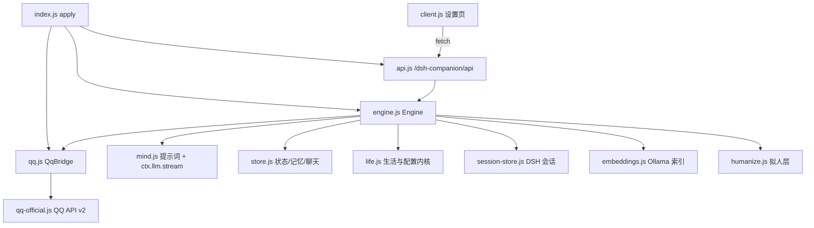

# Repository Guidelines

## Project Overview

单一项目：**shen-xi（沈栖）**，运行在 DeepSeek Harness（DSH）里的 QQ 陪伴插件。产品名与仓库名是 shen-xi，**运行时插件 id / 包名仍是 `dsh-companion`**（DSH profile 依赖、`cordis.patch.yml`、`client.js` 的 `__ModuleLoader__` id、API 前缀都依赖它）。

她拥有确定性的一天（事件、天气、剧情线）、心情/精力/好感度、长期记忆与日记，通过 QQ 官方机器人 API 或 OneBot 11/NapCat 与主人聊天，并在 DSH Web 的 **设置 → 陪伴** 里管理。目标是「像人一样聊天」：拟人层（延迟、睡眠、错字、气泡拆分、复读抑制）是产品核心。

硬性约束：

- **零 npm 依赖**（运行时与开发），只用 Node 内建模块；没有充分理由不加包。
- **无构建、无打包器、无 linter、无 CI**；`client.js` 是手写模块 bundle，原样下发。
- QQ 回复由 `ctx.llm.stream` **单轮生成**——没有 Agent 循环、工具调用或上下文压缩。
- 插件只操作自己的 DSH 会话与 `$DSH_HOME/companion/`，绝不碰其他 Web 会话。

## Architecture & Data Flow



- **宿主侧** `index.js`：`export const name = 'companion'`、`inject = ['llm']`；`apply(ctx)` 依次 `ensureHome` → 构造 `QqBridge` → `SessionStore` → `Engine`，用 `ctx.effect` 挂会话清理、QQ 生命周期、30 秒心跳（`unref()`），再在 `ctx.inject(['webServer'])` 内挂载 API（软依赖，缺失只告警）。
- **聊天流**：QQ WS/HTTP 事件 → `QqBridge.onPrivateMessage`（未绑定则比对 6 位绑定码；否则交给引擎）→ `Engine.handleOwnerMessage`（经 `serial` 队列）→ 构建上下文（人设 + 此刻生活 + 关系 + 相关记忆 + 最近聊天）→ `generateReply` → 写 DSH Session（失败回退 `chat.jsonl`）→ 拆分气泡发送（拟人延迟/错字/清洗）→ 更新心情/好感度 → fire-and-forget 记忆抽取。
- **心跳**：每 30 秒 `Engine.tick()`：21:00 后写日记 → 补回睡眠期间积压的消息 → 检查配置的心跳时刻（带确定性抖动）→ `proactive()` 过安静时段/最小间隔/每日上限后，选一条未分享事件生成；模型可输出 `[SKIP]`。
- **记忆权威**：聊天本体在专属 DSH Session（`companion-qq-*`，侧边栏可见），插件只存 `session.json` 指针；`chat.jsonl` 仅迁移/兜底。状态与记忆文件在 `$DSH_HOME/companion/`（默认 `~/.dsh/companion/`）：`config.json`(0600)、`soul.md`、`state.json`、`memories.json`、`embeddings.json`、`events/`、`diary/`、`guests/`。

## Key Directories

- `companion/` — 仓库根，唯一包。
- `companion/lib/` — 宿主模块：`life.js`（配置/时间/确定性生活/文件 IO）、`store.js`（状态/记忆/聊天）、`mind.js`（提示词/LLM/抽取/日记）、`engine.js`（编排/心跳/记忆 CRUD）、`humanize.js`（拟人纯函数）、`session-store.js`（DSH Session 适配）、`embeddings.js`（Ollama 索引）、`qq.js` / `qq-official.js`（通道）、`api.js`（HTTP 路由）。
- `companion/test/` — 单文件套件 `run.mjs`。
- 根目录 `client.js` — 浏览器设置页；`index.js` — 宿主入口；`cordis.patch.yml` — 把插件插入 DSH profile。

## Development Commands

```sh
cd /home/david/dsh-plugin/companion

node --test test/run.mjs     # 测试（= npm test）
node --check index.js        # 入口语法检查（= npm run check）
node --version               # 必须 >= 22.6
```

安装/重载进 DSH：

```sh
dsh plugin --profile web add /home/david/dsh-plugin/companion
systemctl --user restart dsh-web.service
```

本机 `~/.dsh/profiles/web` 已用 `link:` 指向该仓库，改完只需重启 `dsh-web`；设置页在 **设置 → 陪伴**（浏览器验证可能需要带 `?token=` 登录）。不存在 build/lint/format 命令。

## Code Conventions & Common Patterns

- **语言与命名**：纯 ESM（`"type": "module"`）；英文标识符，中文注释/日志/UI 字符串；日志统一前缀 `[companion]`。每模块一个有状态类（`Engine`、`SessionStore`、`QqBridge`、`QqOfficialClient`、`MemoryIndex`），其余为具名纯函数。
- **依赖注入**：构造器选项是唯一测试缝隙——`{ ctx, root, log, loadConfig, onPrivateMessage, fetchImpl, wsFactory, humanize, livenessTtlMs }`。无 mock 库；模块级 `__internals` 导出（`life.js`、`mind.js`、`humanize.js`、`session-store.js`、`qq-official.js`、`embeddings.js`、`api.js`、`engine.js`）供白盒测试。
- **错误处理**：跨模块边界不抛异常——IO/网络返回 `{ ok, error, ... }` 或 `null`；`readJson` 吞掉解析错误；API 把抛出转成 500 JSON；缺失能力优雅降级（embeddings → 关键词检索，session → `chat.jsonl`，QQ → `simulated`）。
- **并发与持久化**：用 Promise 链串行化代替锁（`Engine.serial`、`store.serializeMemory`），single-flight 在途 Promise（`SessionStore.ensuring`、token 获取）；**`serial()` 不可嵌套**，否则死锁。写入用 tmp + `rename` 原子替换；定时器 `unref()`；所有网络/LLM 调用带 `AbortController` + 超时（LLM 120s、QQ 发送 15s、DSH list/stat 8s、embedding 8s 可配）。
- **确定性**：所有时间判断走 `zoned(date, cfg.timezone)`（`life.js`），入口接受注入的 `now`/`receivedAt`；每日事件用日期键经 FNV `hash32` + `mulberry32` 播种，生活事件绝不用 `Math.random`——同日期 ⇒ 同事件。抖动/延迟/睡眠唤醒/错字同样由文本哈希种子决定。
- **配置与密钥**：`DEFAULT_CONFIG` + `normalizeConfig`（`life.js`）固定形状、丢弃未知键、钳制范围；`config.json` 写入 `0600`。`readJson`/`ensureHome` 遇坏配置备份为 `config.json.broken-*` 后重建。
- **记忆模型**：`memories.json` 一个文件存所有命名空间（主人 `'owner'`、访客 `'guest:<id>'`）；每次写必须 `[...others, ...list]` 全量写回，否则丢别的命名空间。去重用 bigram Jaccard ≥ 0.82（同 owner、同 kind），旧记录进入 `supersedes` 版本链；每个命名空间上限 500。源非 `manual` 的敏感内容（手机号/银行卡/密码等）静默拒绝。
- **QQ 协议**：被动回复窗口 5 分钟，`msg_id` + 每气泡递增 `msg_seq`（按 `msg_id` 记忆，TTL 5 分钟）；主动消息不带 `msg_id`，受平台频控。一条回复最多 4 个气泡；`Engine` 在生成超过 4 分钟后清空 `replyTo`，降级为主动发送。
- **DSH 接缝**：`inject` 只声明 `llm`；`webServer` 用 `ctx.inject`，其余服务（`sessionController`、`sessionPersistence`、`workspaceRegistry`、`sessionTitle`、`agentDefaultModel`）一律 `ctx.get` 特性探测。**会话存活以 `sessionPersistence.stat(id)` 为准**——`inspect()`/`list()` 会把已删除但仍 attached 的幽灵会话算作存活；同时订阅 `api-session/removed`、`session/disposed` 即时清指针。复用已存在会话只能用 `resolveAgent`，`create` 只用于新会话。
- **设置页约束**：`client.js` 无 JSX（`h = React.createElement`）、无 ESM `import`、只 `require('react')`；CSS 是单个内联字符串，类名前缀 `cmp-`，颜色用 `--dsw-alias-*` 设计令牌；数据经 `fetch('/dsh-companion/api' + path)`。loader id 必须等于 `package.json.name`，改包名需同步 profile 依赖、`cordis.patch.yml` 与 API 前缀。
- **已知陷阱**：`client.js` 提示发送「绑定 <code>」，但 `index.js` 只接受去空白后**恰好等于 6 位码**的消息——改绑定流程时两边必须同时改；`README.md` 里 `recentMessages` 默认值 12/30 不一致，代码默认 30；`GET /overview` 会调 `store.status()` → `ensure()`，可能创建/修复会话；API 配置里空字符串 = “保留原密钥”（清空需 `clearSecret`/`clearToken`）。

## Important Files

| 路径 | 职责 |
|---|---|
| `index.js` | 宿主入口：生命周期、QQ 接线与绑定码、30 秒心跳、API 挂载 |
| `client.js` | 设置页 React 组件（概览/记忆/维护/生活/设置 5 个标签） |
| `package.json` | DSH 清单：`engines.node >=22.6`、`engines.dsh 0.2.x`、`dsh.bundle.patch`、`dsh.client.inject`、`files` |
| `cordis.patch.yml` | 把插件实例 `companion` / 包 `dsh-companion` 插入当前 profile |
| `lib/life.js` | `DEFAULT_CONFIG`/`DEFAULT_SOUL`、归一化钳制、`homeRoot`、`ensureHome`、确定性事件、心情/好感度辅助 |
| `lib/store.js` | 状态与记忆持久化、去重/版本链、排序检索、聊天 JSONL |
| `lib/mind.js` | 提示词组装、单轮 `ctx.llm.stream`、记忆抽取、会话摘要、日记；`stripRepeats` 接在生成之后 |
| `lib/engine.js` | 编排器：聊天/主动/心跳/补回/日记、串行队列、`publicConfig` 脱敏、overview 读模型 |
| `lib/humanize.js` | 延迟、气泡间隔、睡眠窗口（01:00–08:30）、清洗、错字、复读抑制、句号归一化与断条 |
| `lib/session-store.js` | DSH Session ensure/adopt/resume、turn 追加与事件投影、遗留 `chat.jsonl` 迁移 |
| `lib/qq.js` / `lib/qq-official.js` | 通道门面 / QQ API v2（token、WS op-code、C2C 发送、`msg_seq`） |
| `lib/embeddings.js` | Ollama `/api/embed` 索引（`embeddings.json`）、余弦 + 关键词混合排序、60 秒失败冷却 |
| `lib/api.js` | `/dsh-companion/api` 路由；同源 + `browserAuth` 防护，1 MiB 请求体上限 |
| `test/run.mjs` | 全部离线测试 |
| `README.md` | 行为规范（数据布局、心跳、记忆门槛、拟人、访客、边界）——行为改动必须同步 |

## Runtime/Tooling Preferences

- **Node ≥ 22.6，不用 Bun**；`node --test` 是唯一运行器，npm 仅作为脚本别名。DSH 宿主版本 `>=0.2.0-rc.2 <0.3.0`。
- 数据根目录由唯一环境变量 `DSH_HOME` 覆盖（`life.js` 的 `homeRoot`）；密钥在 `config.json`（0600），绝不进环境变量、日志或 API 响应。
- 外部进程只有两个，可选且可缺失：本地 Ollama（embeddings，缺失即关键词回退）与 QQ/NapCat（缺失即模拟模式）。
- 浏览器侧无构建产物、无第三方 UI 库；不要在 `client.js` 中引入 `react-dom`、图标库或 Node API。

## Testing & QA

- 框架：Node 内建 `node:test` + `node:assert/strict`，单文件 `test/run.mjs`，约 60 个顶层测试；无 coverage 工具、无并发测试块。
- 测试替身（全部手写 DI）：`tempHome()` 在 `os.tmpdir()` 下 `mkdtemp` 并设 `process.env.DSH_HOME`，`finally` 中 `rm -rf`；`fakeCtx(reply)` 桩 `ctx.llm.stream`（`text-delta`/`finish`）与 `agentDefaultModel`；`fakeSessionController()` 用分离的 `stored`/`live` 集合复现幽灵会话；`fetchImpl` 桩 QQ/Ollama；OneBot 用 `127.0.0.1:0` 本地 HTTP server；WS 从不真正连接。
- 新测试规则：
  - 一律 `new Engine({ ..., humanize: false })`，QQ 发送配置带 `persona: { humanize: false }`，否则真实延迟会把套件从 ~1s 拖到几十秒。
  - 显式传 `now` / `receivedAt`，别依赖真实时钟——01:00–08:30 Asia/Shanghai 的睡眠门控会让消息被 hold 而使断言失败。
  - Engine 测试要关掉 `memory.embedding` 或注入 `fetchImpl`，否则 `recall()` 会探测本机 `127.0.0.1:11434`。
  - `tick()` 内部有 fire-and-forget 的日记/补回；断言后台结果时轮询可观察状态，不要只靠固定 sleep。
  - 覆盖行为与边界（跨夜静默、好感度等级边界、去重阈值、`msg_seq` 递增、绑定匹配、降级路径），不要测接线/转发/源码文本。
- 行为改动必须同步 `README.md`；涉及 `client.js` 的改动没有自动化测试，需重启 `dsh-web` 后在设置页手动验证。
