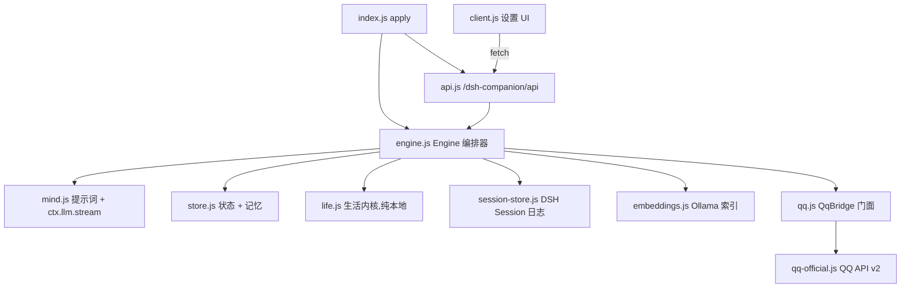

# 仓库指南

## 项目概览

单一项目 — **shen-xi(沈栖,运行时插件 id 仍为 `dsh-companion`)**,DeepSeek Harness(DSH)的宿主插件。一个拥有自己确定性日常生活、心情、精力、好感度与长期记忆的陪伴角色,通过 QQ 官方机器人 API(或 OneBot 11/NapCat)与主人聊天,并通过 DSH Web 的设置页(**设置 → 陪伴**)进行管理。仓库:https://github.com/sswym/shen-xi

塑造每次变更的硬性约束:

- **零 npm 依赖**(运行时 + 开发)。只用 Node 内建模块。没有充分理由绝不引入新包。
- **无构建步骤、无打包器、无 linter、无 CI。** `client.js` 是手写的模块 bundle。
- QQ 回复由插件通过 `ctx.llm.stream` **一次性生成** — 无 Agent 循环、无工具、无上下文压缩。
- 插件只触碰它自己的 DSH 会话和 `$DSH_HOME/companion/`;绝不碰其他 web 会话。

## 架构与数据流

两个半区,都由 DSH 宿主加载:

- **宿主侧** — `companion/index.js`:cordis 风格插件(`export const name = 'companion'`、`inject = ['llm']`、`async apply(ctx)`)。`apply` 初始化 `$DSH_HOME/companion/`,启动 QQ 桥(`ctx.effect`),运行 30 秒心跳定时器(`ctx.effect`,`unref()`),并在 `ctx.inject(['webServer'])` 内挂载 `/dsh-companion/api`。
- **浏览器侧** — `companion/client.js`:通过 `window.__ModuleLoader__.load({id, factory})` 注册;factory 返回一个迷你插件,注入设置插槽(id `'companion'`,标签 陪伴,顺序 12)。

`companion/lib/` 下的模块分层(依赖向下指):



消息流:QQ WS 事件 → `QqBridge.onPrivateMessage`(通过 OpenID 或 6 位绑定码做主人校验)→ `Engine.handleOwnerMessage`(**经串行队列**)→ 构建上下文(人设 + 生活状态 + 相关记忆 + 近期聊天)→ `generateReply` → 追加到 DSH Session → 发送 QQ 气泡 → 更新心情/好感度 → fire-and-forget 记忆抽取。心跳:`engine.tick()` 检查安静时段 / 最小间隔 / 每日上限,选一条未分享(已发生)的事件,模型回复或 `[SKIP]`。

聊天权威是**专属 DSH 会话**(`companion-qq-*`,侧边栏可见);插件只保留指针(`session.json`),若会话被删除/归档则自动新建。

状态存于 `$DSH_HOME/companion/`(默认 `~/.dsh/companion/`):`config.json`(chmod 0600,密钥)、`soul.md`(人设)、`state.json`(心情/精力/好感度)、`memories.json`(≤500)、`embeddings.json`(可重建)、`events/`、`diary/`、`session.json`。

## 关键目录

- `companion/` — 整个仓库;无其他顶层目录。
- `companion/lib/` — 9 个宿主模块(见下)。
- `companion/test/` — 单文件套件 `run.mjs`。

## 开发命令

```sh
cd companion
node --test test/run.mjs        # 测试(等价:npm test)
node --check index.js           # 入口语法检查(npm run check)

# 安装 / 重载进 DSH
dsh plugin --profile web add /home/david/dsh-plugin/companion
systemctl --user restart dsh-web.service
```

不存在 build/lint/format 命令。改动后运行测试套件验证;运行时改动则重启 `dsh-web` 并检查设置页。

## 代码约定与常见模式

- 纯 ESM(`"type": "module"`),Node ≥ 22.6,全局 `fetch`/`WebSocket`。英文标识符;中文文档注释、日志行与 UI 字符串(日志前缀 `[companion]`)。
- 每模块一个有状态类(`Engine`、`SessionStore`、`QqBridge`、`QqOfficialClient`、`MemoryIndex`);其余均为具名纯函数。
- **经构造器选项做 DI** — `{ ctx, root, log, loadConfig, onPrivateMessage, fetchImpl, wsFactory }` 可注入供测试。无 mock 库。
- **`__internals` 导出**供白盒测试:`life.js`、`mind.js`、`session-store.js`、`qq-official.js`。
- **跨模块边界不抛异常**:IO 返回 `{ ok, error, ... }` 结果对象;`readJson` 吞掉解析错误;API 把抛出转成 500 JSON。错误优雅降级(embeddings → 关键词搜索,session → `chat.jsonl` 回退,QQ → 模拟模式)。
- **用 Promise 链串行化代替锁**:`Engine.serial`、`store.js` 的 `serializeMemory`、single-flight 在途 Promise(`SessionStore.ensuring`、token 获取)。
- 原子文件写入:tmp 文件 + `rename`。定时器 `unref()`。所有网络/LLM 调用带 `AbortController` + 超时(LLM 120 秒,QQ 发送 15 秒)。
- 确定性:每日事件由日期键经 FNV `hash32` + `mulberry32` 播种 — 生活事件绝不用 `Math.random`;同日期 ⇒ 同事件。
- `normalizeX` 配置净化器带钳制;默认值在 `DEFAULT_CONFIG`(`life.js`)。
- 密钥绝不离开宿主:`publicConfig`(`engine.js`)置空 `appSecret`/`accessToken` 并暴露 `hasSecret` 类布尔值;`saveConfig` 在空字符串补丁时保留密钥。
- `client.js`:无 JSX — `h = React.createElement`;CSS 为内联字符串,`cmp-` 类前缀 + `--dsw-alias-*` 设计令牌;数据经 `fetch('/dsh-companion/api' + path)`。

## 重要文件

| 路径 | 职责 |
|---|---|
| `companion/index.js` | 宿主入口;生命周期、QQ 接线、心跳、API 挂载 |
| `companion/client.js` | 设置 UI(5 个标签页:总览/记忆/维护/生活/设置) |
| `companion/package.json` | DSH 清单:`engines`(node ≥22.6,dsh `0.2.x-rc`)、`dsh.bundle.patch`、`dsh.client.inject` |
| `companion/cordis.patch.yml` | 把插件 id `companion` 插入 DSH profile |
| `companion/lib/life.js` | 生活内核:配置、默认人设、时区、确定性事件、心情/好感度辅助函数、文件 IO |
| `companion/lib/store.js` | 状态 + 记忆持久化;去重(bigram Jaccard ≥ 0.82 的 `supersedes` 链)、500 上限、敏感数据拒绝 |
| `companion/lib/mind.js` | 提示词组装、`ctx.llm.stream` 调用、记忆抽取、日记、会话摘要 |
| `companion/lib/engine.js` | 编排器:聊天/主动/心跳、串行队列、`publicConfig` |
| `companion/lib/api.js` | `/dsh-companion/api` 路由;同源 + `browserAuth` 防护,1 MiB 请求体上限 |
| `companion/lib/qq.js` / `qq-official.js` | 通道门面 / QQ 官方 API v2(token、WS 网关 op-code、C2C 发送、`msg_seq`) |
| `companion/lib/session-store.js` | DSH Session 适配器:ensure/adopt/resume、遗留 `chat.jsonl` 迁移 |
| `companion/lib/embeddings.js` | Ollama `/api/embed` 索引(768 维),余弦 + 关键词 + 权重排序,60 秒失败冷却 |
| `companion/README.md` | 深度行为规范:记忆门槛、心跳节奏、会话轮换、数据布局 — 行为改动前必读 |

## 运行时/工具偏好

- **Node ≥ 22.6,不用 Bun。** `node --test` 是运行器;npm 仅作为脚本别名存在。
- DSH 宿主 `>=0.2.0-rc.2 <0.3.0`;插件只与宿主服务交互(`llm`、`webServer`、`sessionController`、`agentDefaultModel`、`workspaceRegistry`)。
- `DSH_HOME` 环境变量覆盖数据根目录(`life.js` 的 `homeRoot(env)`)— 唯一的环境变量;密钥存于 `config.json`(0600),绝不进环境变量。
- 可选的本地 Ollama 做 embeddings;缺失是受支持的状态(关键词回退)。

## 测试与 QA

- 框架:Node 内建 `node:test` + `node:assert/strict`;单文件 `companion/test/run.mjs`(约 40 个测试)。无覆盖率工具。
- 测试替身经 DI 缝隙手写:
  - `tempHome()` — 在 `os.tmpdir()` 下 `mkdtemp`,设 `process.env.DSH_HOME`,`ensureHome()`,`finally` 中 `rm -rf`。
  - `fakeCtx()` — 把 `ctx.llm.stream` 桩成产出 `text-delta`/`finish` 的异步生成器,外加 `ctx.get('agentDefaultModel')`。
  - `fetchImpl` 注入用于 QQ 官方 API + Ollama;`node:http` 服务器用于 OneBot;Engine 测试用内联桩桥。
- 套件离线且确定;任何改动后从 `companion/` 运行。新测试必须遵循同样的 DI 风格(无网络、无真实 DSH 宿主),并针对行为/边界(安静时段跨夜范围、好感度等级边界、去重阈值、`msg_seq` 递增)。
